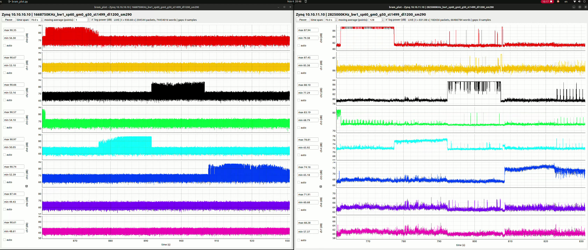
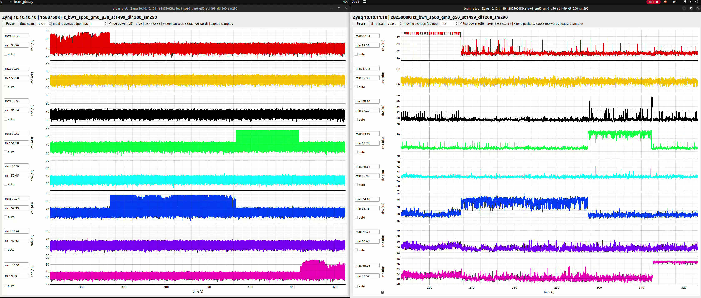
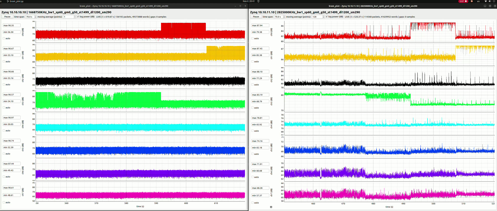
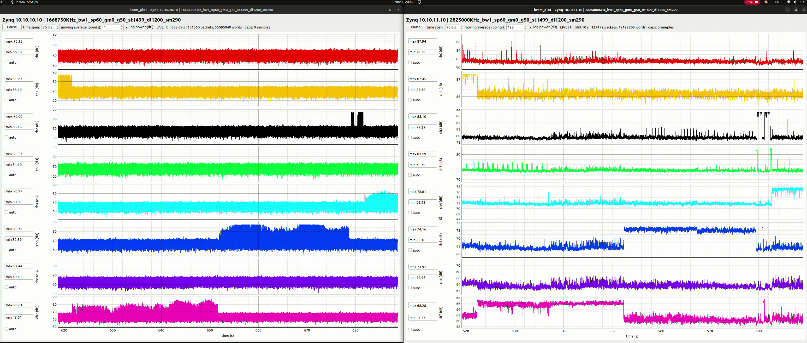
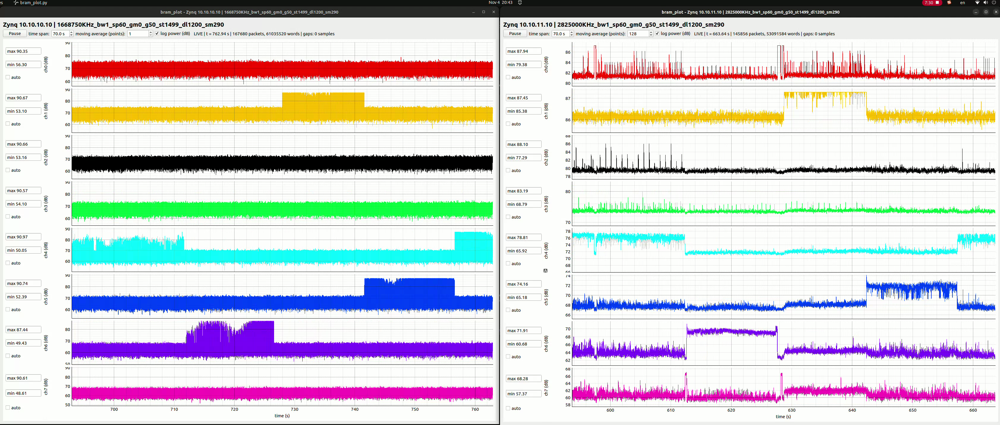

80,000 channel hops per second with hardware-controlled AD9361 frequency hopping

I replaced the previous software-controlled AD9361 frequency-hopping implementation, which achieved 10,000 hops per second [1,2], with hardware-controlled hopping, enabling measurements 
at 80,000 hops per second.

The AD9361 measurement system channel is switched every 12.5 µs, allowing all eight Starlink channels to be scanned in just 100 µs.

Although the AD9361 datasheet specifies a channel-switching settling time of 20–30 µs, my measurements show that 10 µs is sufficient for stable in-band energy measurements (not checking the 
signal quality, EVM, SNR etc.). The remaining 2.5 µs is used for energy integration.

The new hardware-controlled frequency-hopping system successfully reproduced the RF behavior previously observed using software-controlled hopping [1,2,3,4], 
further strengthening confidence in the validity of these Starlink terminal measurement experiments.

Using two SDRs and two LNBs to simultaneously measure Starlink terminal transmissions [1,2] and receiver LO leakage [3,4], I confirmed that, during normal operation, 
the terminal consistently selects the same channel number for both uplink and downlink. In other words, the uplink and downlink channels are paired via choosing the same channel number 
(TDD switching between UL and DL), even though their center frequencies are different (FDD).

Starlink downlink channel numbers 0–7 correspond to eight 500 MHz channels spanning 10.7–12.7 GHz. 
Uplink channel numbers 0–7 correspond to eight 62.5 MHz channels spanning 14.0–14.5 GHz.

Another finding that surprised me was the relatively strong RF signals radiation from an ordinary consumer Starlink terminal. 
I am not sure whether this degree of radiation level is expected behavior or not, what I do observe is that even at a distance of several meters, 
an normal satellite TV LNB can still pick up clearly detectable transmission signals and receiver local-oscillator leakage, 
even when its feed horn is pointed away from the back of the terminal's phased-array antenna.

This measurement deliberately used such a configuration, with the LNB positioned several meters away and facing away from the terminal's back. Otherwise, 
adjacent-channel leakage would have been much more prominent.

In theory, a Starlink terminal communicates with a satellite using a narrow, pencil-shaped beam with a beamwidth of approximately 1–2 degrees. 
Such a narrow beam should, in principle, have a low probability of interception. In practice, however, the terminal's phased-array antenna appears to produce detectable signals 
in multiple directions (side lobe or Spurious emission?), including behind the antenna, at distances of several meters, using nothing more than an ordinary satellite TV LNB.

These observations may provide a basis for estimating the off-axis RF (Tx signal and Rx LO Leakage) power level of an ordinary consumer Starlink terminal through link-budget calculations.

Real-time visualization

I also vibe-coded a real-time visualization interface, making it possible to observe uplink transmission activity and downlink LO leakage simultaneously by human eyes.
Those N*15s period channel switching event can be seen very obviously by human eyes.

When a Starlink speed test is started, uplink transmissions become significantly denser, appearing almost continuous in the plots. 
This confirms that the measurements are indeed capturing actual ongoing Starlink terminal activity rather than random environmental interference.

Below are several screenshots captured during real-time measurements.

Each row represents one channel. Vertical axis: Signal strength (dB). Horizontal axis: Time (seconds), with a total span of 70 seconds
The left panel shows activity across the eight uplink channels (measured by scanning 8 possible UL frequencies of transmitted RF signals).
The right panel shows activity across the eight downlink channels (measured by scanning 8 possible DL frequencies of receive local-oscillator leakage).

During ten minutes of visual observation, I did not observe a single instance in which the uplink and downlink channel numbers differed.

[1] https://sdr-x.github.io/starlink-UL-channel-switch/

[2] https://sdr-x.github.io/starlink-UL-cold-start/

[3] https://sdr-x.github.io/starlink-rx-lo-scan-leakage/

[4] https://sdr-x.github.io/starlink-dl-scan-reboot/

<noscript>Please enable JavaScript to view the <a href="http://disqus.com/?ref_noscript">comments powered by Disqus.</a></noscript>

<!-- Global site tag (gtag.js) - Google Analytics -->

