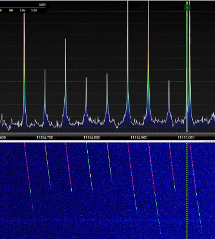
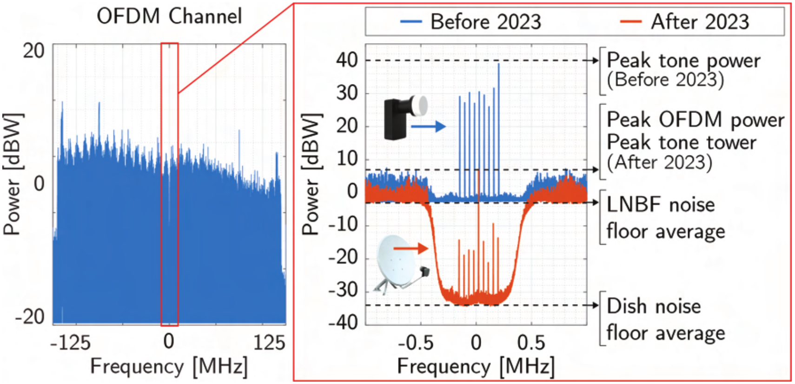
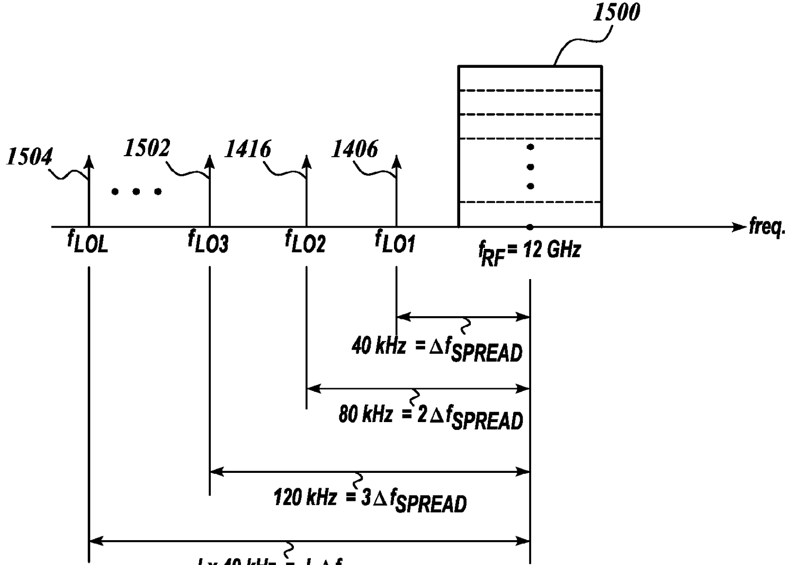
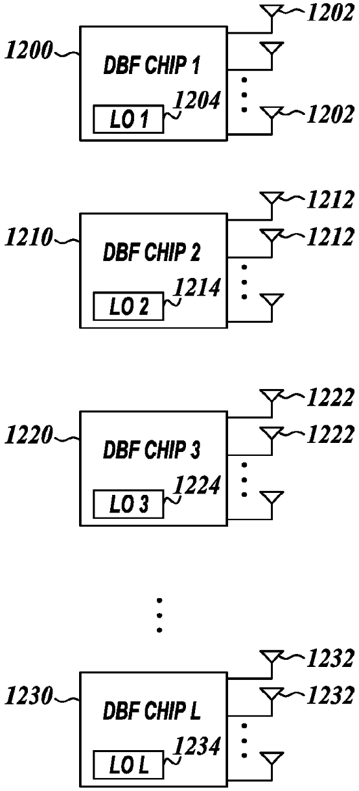
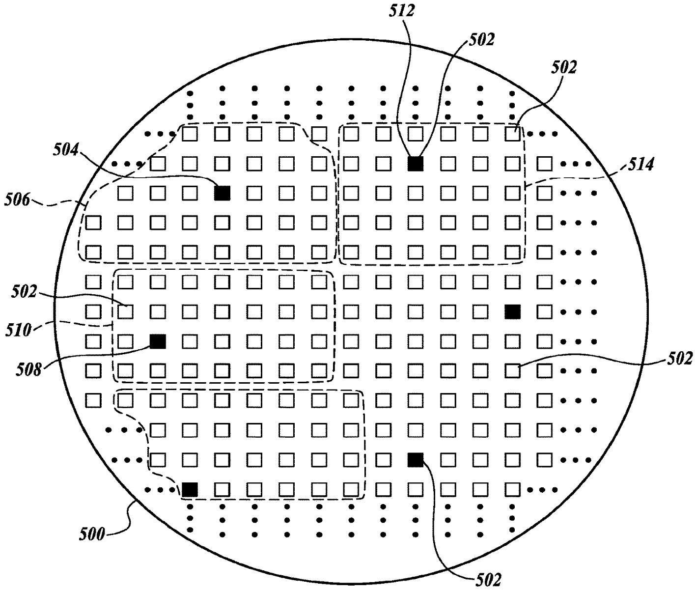

Why does the Starlink satellite downlink beacon consist of nine spectral lines? Are they transmitted intentionally, or are they unintended emissions? If they are simply local oscillator (LO) leakage, why are there nine spectral lines instead of just one?

The mystery has finally been solved!

Anyone who has received Starlink satellite downlink signals is probably familiar with the nine narrow spikes in the center of the spectrum. Many people refer to them as beacons. (https://forum.amsat-dl.org/index.php?thread/3981-receiving-starlink-satellite-beacons/)

The earliest and most well-known beacon signal was observed near 11.325 GHz, the center frequency of the third Starlink downlink channel.

More rigorous measurements published in an academic paper found that the frequency spacing between these spikes is approximately 43.9455 kHz. (https://people.engineering.osu.edu/media/document/2025-08-06/kassas_unveiling_starlink_for_pnt.pdf)

Some reports have also pointed out that these beacons can be received even in areas where Starlink service is not available.

This raises an interesting question: Are these beacons deliberately transmitted by Starlink satellites, or are they simply unintended local oscillator leakage?

Normally, LO leakage produces just one spectral line at the LO frequency. However, many reports of received Starlink downlink signals show multiple spectral lines, typically nine. This is quite different from conventional LO leakage.

The answer can be found in this US patent: US12615097B2 — Near Zero Intermediate Frequency (NZIF) Compensation of Local Oscillator Leakage.

Behind each element of a Starlink satellite's phased-array antenna is a zero-IF transceiver.

In conventional designs, the local oscillators of all these zero-IF transceivers are locked to the same RF carrier frequency. As a result, the actual radiated signal contains both the desired communication signal and LO leakage at the same center carrier frequency.

The desired communication signals undergo real-time digital signal processing and are coherently combined to form a pencil beam. However, the LO leakage signals, despite having exactly the same frequency, have random phases. When radiated by multiple antenna elements, they undergo uncontrolled coherent addition or cancellation in space.

If these signals happen to add coherently, their combined power spectral density may exceed regulatory limits.

According to the patent, Starlink's solution works as follows:

A small frequency offset is first introduced into the communication signal in the digital baseband. The patent gives an example of: delta-F = 40kHz.

The local oscillator of zero-IF transceiver is then tuned with a small frequency offset in the opposite direction relative to the target carrier frequency.

The two frequency shifts effectively cancel each other out for the desired communication signal. Consequently, the communication signal remains centered at the intended center frequency.

However, the LO leakage is no longer located at the center frequency. Instead, it appears at the center frequency plus or minus the small frequency offset.

By assigning different small frequency offsets to different local oscillators (with opposite offsets in the digital baseband accordingly), 
the resulting LO leakage signals are no longer coherent with one another (thanks to the frequency shifting). This greatly reduces the risk of accidental coherent addition that could cause the radiated power spectral density to exceed regulatory limits.

The following diagram illustrates this principle.

In this example, the resulting RF local oscillator leakage signals are separated by approximately 40 kHz. This closely matches the approximately 44 kHz spacing between the nine spectral lines reported in many Starlink observations.

Why nine different LO leakage frequencies rather than four or a thousand?

This is probably an engineering trade-off between performance and implementation complexity.

The more different frequency offsets are used, the more complex the LO generation hardware becomes. Fewer frequency offsets mean a simpler implementation. In the extreme case, with no frequency offsets at all -- the traditional case: all transceivers can share the same LO, but with the disadvantage described before.

Starlink satellites contain multiple large-scale digital beamforming (DBF) chips. Each DBF chip is responsible for processing the antenna elements within one subregion of the entire antenna array.

Within each DBF chip, multiple zero-IF transceivers share the same local oscillator (I guess). Different DBF chips, however, use different small frequency offsets for their local oscillators (I guess. although I suspect these oscillators may still be derived from a general common source on the satellite).

This provides a good engineering compromise between implementation complexity and performance.

Therefore, my hypothesis is that the nine spectral lines indicate nine different LO frequency offsets on the satellite, corresponding to nine DBF chips.

The patent includes the following architecture diagrams.

Interestingly, while studying the Starlink terminal's uplink signals, I also observed that the DC spikes near the carrier frequency do not overlap:
"DC spikes appear at slightly different locations in the figure." (https://sdr-x.github.io/starlink4/)

This gives us reason to suspect that Starlink user terminals employ a similar design.

This is also consistent with the earlier Starlink patent US12003350 analysis (https://sdr-x.github.io/starlink-supplement1/), which describes a unified modem architecture adopted across satellites, user terminals, and gateway stations.

<noscript>Please enable JavaScript to view the <a href="http://disqus.com/?ref_noscript">comments powered by Disqus.</a></noscript>

<!-- Global site tag (gtag.js) - Google Analytics -->

